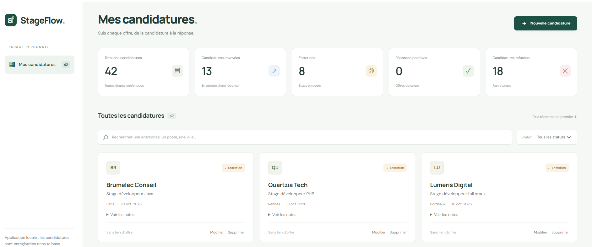

# StageFlow

Application web de suivi de candidatures de **stage et d'alternance**.
Un carnet personnel pour centraliser les offres, suivre les réponses et préparer ses entretiens.



## Fonctionnalités

- Créer, consulter, modifier et supprimer des candidatures persistées dans MySQL.
- Suivre cinq étapes : à postuler, envoyée, entretien, acceptée, refusée.
- Rechercher par entreprise, poste ou ville et filtrer par statut.
- Visualiser les compteurs, conserver des notes et ouvrir le lien d'une offre.
- Valider les formulaires, afficher les erreurs et confirmer les suppressions.
- Interface française responsive, utilisable au clavier.

## Stack et architecture

Java 21 · Spring Boot 4.1.1 · Maven · Spring Data JPA · Hibernate · MySQL 8 · React · Vite · JUnit · Vitest

```text
React → HTTP / JSON → Controller → Service → Repository → JPA / Hibernate → MySQL
```

```text
src/main/java/com/stageflow/backend/
├── controller/       Routes HTTP et codes de réponse
├── dto/              Contrat JSON et validation des entrées
├── entity/           Entité persistée et enum des statuts
├── exception/        Erreurs API centralisées
├── repository/       Accès aux données Spring Data JPA
├── service/          Opérations métier et transactions
└── validation/       Validation des URL HTTP(S)
frontend/src/
├── components/       Cartes, formulaire et fenêtre modale
├── api.js            Appels HTTP au backend
├── App.jsx           Écran principal et état de l'interface
└── statuses.js       Libellés des statuts et formatage des dates
```

## Lancement local — Windows / PowerShell

Prérequis : Java 21, MySQL démarré, Node.js 22.12 ou plus récent (testé avec 24) et npm. Le wrapper télécharge Maven au premier lancement.

### 1. Base MySQL

Créer la base de données en exécutant dans MySQL :

```sql
CREATE DATABASE IF NOT EXISTS stageflow CHARACTER SET utf8mb4 COLLATE utf8mb4_unicode_ci;
```

Configuration par défaut : `jdbc:mysql://localhost:3306/stageflow`, utilisateur `root`, mot de passe vide.
Si ton installation utilise un autre compte, définir ces variables **dans le terminal qui lance le backend** :

```powershell
$env:DB_USERNAME = "ton_utilisateur"
$env:DB_PASSWORD = "ton_mot_de_passe"
# Facultatif si MySQL utilise un autre port ou une autre machine :
$env:DB_URL = "jdbc:mysql://localhost:3306/stageflow"
```

Les secrets ne doivent pas être écrits dans Git. Un fichier `.env` n'est pas chargé automatiquement par Spring Boot.
Hibernate crée ou met à jour la table `applications` au démarrage grâce à `ddl-auto=update`.

### 2. Backend — terminal 1, à la racine

```powershell
.\mvnw.cmd spring-boot:run
```

API : <http://localhost:8080/api/applications>.
Si le wrapper rencontre `Cannot start maven from wrapper` dans un environnement Windows particulier, utiliser Maven installé :

```powershell
mvn spring-boot:run
```

Si Maven cherche son cache dans `C:\.m2`, préciser son emplacement :

```powershell
mvn "-Dmaven.repo.local=$env:USERPROFILE/.m2/repository" spring-boot:run
```

### 3. Frontend — terminal 2

```powershell
cd frontend
npm.cmd ci
npm.cmd run dev
```

Ouvrir **<http://localhost:5173>**. Le proxy Vite transmet `/api` au backend sur le port 8080.
Aucune candidature fictive n'est insérée automatiquement. Créer la première via le bouton « Nouvelle candidature ».
`Ctrl+C` arrête chaque serveur. Si un port est occupé, arrêter l'ancienne instance avant de relancer.

## API REST

| Méthode | Route | Résultat |
|---|---|---|
| GET | `/api/applications` | 200, liste triée par date puis id décroissants |
| GET | `/api/applications/{id}` | 200, une candidature |
| POST | `/api/applications` | 201, candidature créée et en-tête Location |
| PUT | `/api/applications/{id}` | 200, candidature remplacée |
| DELETE | `/api/applications/{id}` | 204, aucun contenu |

Champs obligatoires : `company` (120 caractères), `position` (160), `applicationDate` (ISO `yyyy-MM-dd`) et `status`.
Champs facultatifs : `location` (160), `offerUrl` (2048, HTTP/S), `notes` (5000).
L'identifiant `id` est généré par MySQL. Un champ facultatif vide est stocké `NULL` en base et retourné comme chaîne vide dans le JSON.
Les espaces en début et fin de saisie sont retirés, y compris autour du lien de l'offre.
Les dates futures sont permises pour planifier une candidature. Les statuts sont librement modifiables.
PUT attend tous les champs obligatoires et remplace aussi les champs facultatifs.

```json
{
  "company": "Entreprise Exemple",
  "position": "Développeur Java en alternance",
  "location": "Paris",
  "offerUrl": "https://example.com/offre",
  "applicationDate": "2026-09-29",
  "status": "APPLIED",
  "notes": "CV envoyé, préparer la relance."
}
```

Les cinq statuts API sont `TO_APPLY`, `APPLIED`, `INTERVIEW`, `ACCEPTED`, `REJECTED`.
Une saisie invalide retourne **400** ; un identifiant absent ou une route inconnue retourne **404** ; une méthode non autorisée retourne **405** ; une erreur imprévue retourne **500** (détails dans les journaux, pas dans la réponse). Toutes ces erreurs ont le même format JSON.

```json
{
  "message": "Vérifie les champs du formulaire.",
  "errors": { "company": "L'entreprise est obligatoire." }
}
```

## Tests et builds

```powershell
# Racine : tests JUnit et création du JAR exécutable
.\mvnw.cmd verify

# Frontend
cd frontend
npm.cmd test
npm.cmd run build
```

Les tests JUnit utilisent le profil `test`, une base H2 en mémoire et un serveur HTTP sur un port aléatoire.
Ils vérifient les parcours CRUD, la persistance entre requêtes, les statuts, le stockage `NULL` des champs facultatifs, les liens invalides ou entourés d'espaces et le format des erreurs 400, 404 et 405.
Ils ne touchent pas la base MySQL personnelle ; H2 ne remplace pas une vérification MySQL réelle.
Pour vérifier le CRUD sur MySQL avec le backend démarré, lancer `powershell -ExecutionPolicy Bypass -File scripts/smoke-test.ps1` : le script crée une candidature temporaire puis la supprime.
Les tests React exécutent les interactions utilisateur et simulent uniquement la frontière HTTP : filtres, compteurs, création, modification, suppression, erreurs, accessibilité des champs et navigation au clavier pendant la sauvegarde. `api.js` et `statuses.js` ont aussi leurs tests unitaires.

Le workflow `.github/workflows/ci.yml` lance les tests et builds à chaque push et pull request sur GitHub.
Le frontend est formaté avec Prettier : `npm.cmd run format` applique le format et `npm.cmd run format:check` le vérifie.

Après `verify`, le backend peut aussi être démarré par :

```powershell
java -jar target/stageflow-backend-0.0.1-SNAPSHOT.jar
```

Après le build frontend, `npm.cmd run preview` sert un aperçu local sur le port 4173, avec le même proxy API.

## Documentation

- [Guide pédagogique](docs/guide-pedagogique.md) : chaque annotation Spring et chaque automatisme, dans l'ordre de construction.

## Périmètre et suites possibles

Cette version est une **application personnelle locale, sans authentification** : les candidatures ne sont pas séparées par compte.
Les serveurs écoutent par défaut sur la boucle locale. Avant un hébergement public : authentification, autorisations par utilisateur, migrations Flyway, configuration de production et tests MySQL automatisés seraient nécessaires.
`ddl-auto=update` simplifie le développement ; ce n'est pas une stratégie de migration de production.
Autres évolutions possibles : pagination, rappels de relance, pièces jointes et statistiques par période.

## Auteur

Projet réalisé par **Khadidja Ahmat Hassan**.
